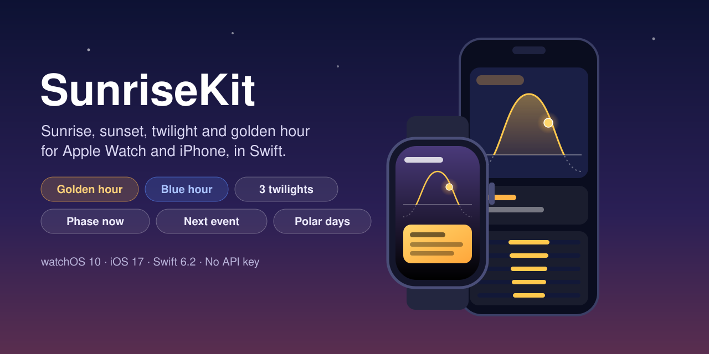
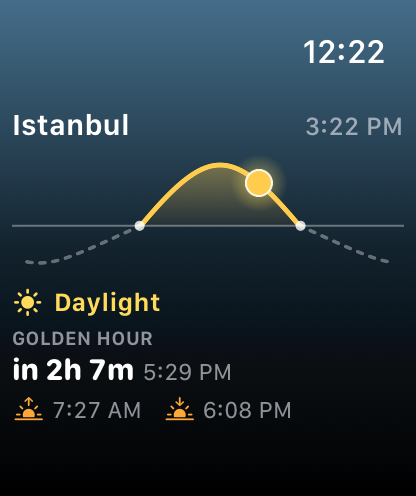
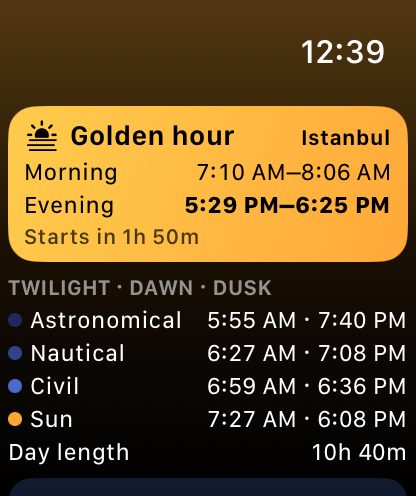
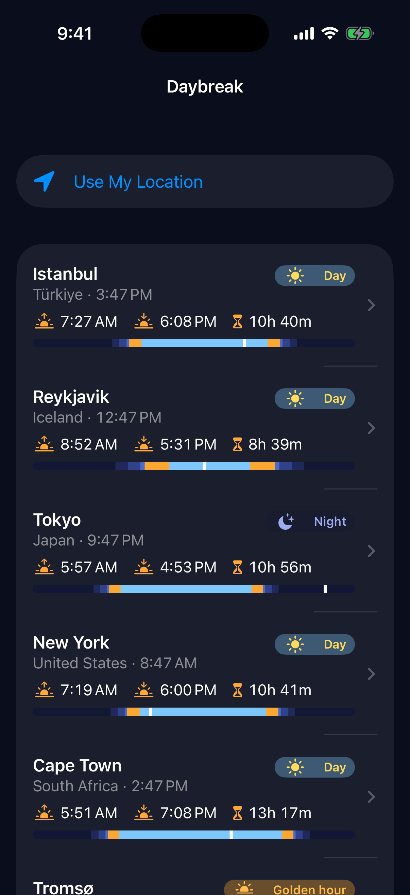
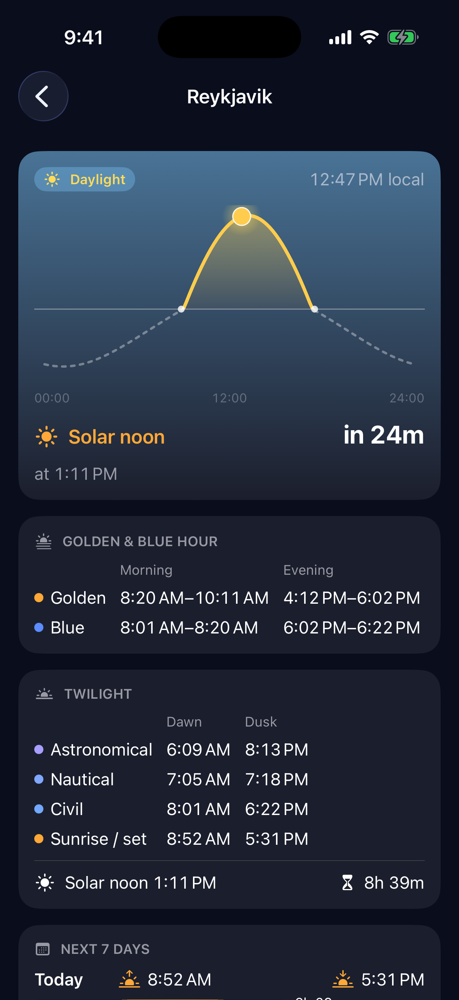

<p align="center">
  
</p>

<p align="center">
  <a href="https://github.com/halilozel1903/SunriseKit/actions/workflows/ci.yml"></a>
  
  
  
  
  
  
  <a href="LICENSE"></a>
</p>

**SunriseKit** is a Swift client for the free [Sunrise Sunset API](https://sunrise-sunset.org/api) by [sunrise-sunset.org](https://sunrise-sunset.org), with SwiftUI views and an example **Apple Watch and iPhone** app. Ask for a day's **sunrise, sunset, solar noon, day length** and the **civil, nautical and astronomical twilights**, and SunriseKit adds what photographers and outdoor apps need on top: **golden hour and blue hour** windows, the **light phase right now**, a **countdown to the next event** and the day as a **0–1 timeline** for drawing a sun arc. Polar day and polar night are handled: the API's `1970-01-01` placeholders become `nil`, and SunriseKit tells midnight sun from polar night. No API key, no dependencies.

```swift
import SunriseKit

let sun = SunriseSunsetClient()
let istanbul = TimeZone(identifier: "Europe/Istanbul")!

let today = try await sun.sunTimes(latitude: 41.0082, longitude: 28.9784, timeZone: istanbul)

today.sunrise                                   // Date? 07:18 local
today.sunset                                    // Date? 18:19 local
SunFormat.duration(today.dayLength)             // "11h 01m"
today.goldenHour.evening                        // SunWindow 17:42–18:36
today.phase(at: .now)                           // .goldenHour
today.nextEvent(after: .now)?.kind              // .sunset
today.timeline.fraction(at: .now)               // 0.74 (of the local day)
```

## Screenshots

Captured by CI from the example app, *Daybreak*, on an Apple Watch and an iPhone simulator. Every scene loads **today's real sun times from the live sunrise-sunset.org API** for real cities and shows them at the **real current time** of the CI run: the sun's position on the arc, the phase and the countdown are whatever they were when the job ran (so a watch capture can just as well show night as daylight). Only the iPhone status bar is set to 9:41; the times inside the app are the real local times. If the API cannot be reached, the job fails instead of saving a capture.

| Watch: sun arc | Watch: golden hour |
| :---: | :---: |
|  |  |

| iPhone: cities | iPhone: city detail |
| :---: | :---: |
|  |  |

## Features

- **The whole API**: `GET https://api.sunrise-sunset.org/json` with `lat`, `lng`, `date` (a day, `today` or `tomorrow`), `formatted=0` for ISO 8601 times and the day length in seconds, and `tzid` so times and "today" are local to the place.
- **Every status**: `OK`, `INVALID_REQUEST`, `INVALID_DATE`, `UNKNOWN_ERROR` and `INVALID_TZID` map to `SunriseSunsetStatus`. Errors throw `SunriseSunsetError.status(_:)`; `UNKNOWN_ERROR` is marked retryable; an `INVALID_TZID` can be accepted as UTC times with `allowsUTCFallback`. Out-of-range coordinates and impossible dates are rejected before any request.
- **Date ranges**: version 1 of the API has no `date_start`/`date_end`, so `sunTimes(for:from:through:)` and `sunTimes(for:startingOn:count:)` send one request per day, a few at a time, and return the days in order (up to 31).
- **Typed `SunTimes`**: sunrise, sunset, solar noon, day length and the begin and end of civil, nautical and astronomical twilight as `Date?`, with the local `CalendarDay` and `TimeZone`. `Codable`, `Hashable`, `Sendable`.
- **Polar day and night**: the API answers `1970-01-01T00:00:01+00:00` for events that do not happen. SunriseKit turns each one into `nil` on its own (a white night can have a sunrise but no civil dusk), sets `sunStatus` to `.normal`, `.midnightSun` or `.polarNight` from the sun's noon altitude, and reports a day length of 24 h or 0 instead of the API's 0 for both.
- **Golden and blue hour**: `goldenHour` (sun between −4° and +6°) and `blueHour` (−6° to −4°) as morning and evening `SunWindow`s, plus `civilTwilight`, `nauticalTwilight`, `astronomicalTwilight` and `daylight`. Change the altitudes with `GoldenHourDefinition`. These come from NOAA's solar equations anchored at the API's solar noon, because the API does not report them.
- **Phase now**: `phase(at:)` returns `.night`, `.astronomicalTwilight`, `.nauticalTwilight`, `.civilTwilight` (the blue hour), `.goldenHour` or `.day`, with titles and SF Symbols.
- **Next event countdown**: `events()` lists all 13 moments of the day in order; `nextEvent(after:)` finds the next one, and on `[today, tomorrow]` keeps counting after the last dusk.
- **Timeline for drawing**: `DayTimeline` maps local midnight to midnight onto 0…1 (`fraction(at:)`, `date(at:)`), splits the day into phase segments and handles 23 and 25 hour days. `altitude(at:)` gives the sun's height for an arc.
- **SwiftUI, optional**: `SunriseUI` has `SunArcView`, `DayTimelineBar`, `DaylightBar`, `SunPhaseBadge`, `SunriseAttributionView` and phase colours. They run on Apple Watch, iPhone and the Mac.
- **Tested**: Swift Testing with recorded-shape fixtures (Istanbul, a Reykjavik white night, Longyearbyen midnight sun and polar night, near the North Pole) and a `URLProtocol` stub, on macOS, iOS and watchOS.

## API coverage

| API | SunriseKit |
| --- | --- |
| `GET /json?lat&lng` | `sunTimes(latitude:longitude:date:timeZone:)`, `sunTimes(for:date:timeZone:)` or `sunTimes(_ request: SunTimesRequest)` → `SunTimes` |
| `date=YYYY-MM-DD`, `today`, `tomorrow` | `SunDate.day(CalendarDay)`, `.today`, `.tomorrow` |
| `formatted=0` | always sent; ISO 8601 times parsed by `SunriseSunsetTime` |
| `tzid` | `timeZone:`; `allowsUTCFallback` for `INVALID_TZID` |
| a range of days | `sunTimes(for:from:through:timeZone:)`, `sunTimes(for:startingOn:count:timeZone:)` → `[SunTimes]` (one request per day) |
| `status` | `SunriseSunsetStatus`, thrown as `SunriseSunsetError.status(_:)` |

| Derived | |
| --- | --- |
| `goldenHour`, `blueHour`, `goldenHour(_:)` | `DayWindows` with `morning` and `evening` `SunWindow?` |
| `civilTwilight`, `nauticalTwilight`, `astronomicalTwilight`, `daylight` | windows from the API's times |
| `phase(at:)`, `isMorning(at:)`, `sunProgress(at:)`, `altitude(at:)` | the light and the sun's position at a moment |
| `events()`, `nextEvent(after:)`, `SunEvent.countdown(from:)` | sun events in order and the next one |
| `timeline` (`DayTimeline`) | `fraction(at:)`, `date(at:)`, `segments`, `phase(at:)` |
| `sunStatus` | `.normal`, `.midnightSun`, `.polarNight` |

## Installation

In Xcode choose **File › Add Package Dependencies…** and enter:

```
https://github.com/halilozel1903/SunriseKit
```

Or add it to `Package.swift`:

```swift
dependencies: [
    .package(url: "https://github.com/halilozel1903/SunriseKit", from: "1.0.0")
],
targets: [
    .target(name: "MyApp", dependencies: [
        .product(name: "SunriseKit", package: "SunriseKit"),
        .product(name: "SunriseUI", package: "SunriseKit"),   // optional SwiftUI views
    ])
]
```

## Usage

### One day

```swift
let sun = SunriseSunsetClient.shared
let tokyo = TimeZone(identifier: "Asia/Tokyo")!

let day = try await sun.sunTimes(
    for: Coordinate(latitude: 35.6762, longitude: 139.6503),
    date: .day(CalendarDay(year: 2026, month: 12, day: 21)),
    timeZone: tokyo
)
day.solarNoon                                   // Date
day.civilTwilightBegin                          // Date?
day.astronomicalTwilightEnd                     // Date?
SunFormat.time(day.sunrise, in: tokyo)          // "6:47 AM"
```

Pass the place's time zone: it makes `today` the place's local day and the times local. Without one, the API uses UTC.

### A week

```swift
let week = try await sun.sunTimes(
    for: coordinate,
    startingOn: CalendarDay(.now, in: tokyo),
    count: 7,
    timeZone: tokyo
)
for (yesterday, today) in zip(week, week.dropFirst()) {
    print(today.day, SunFormat.change(today.dayLength - yesterday.dayLength))   // "+0m 41s"
}
```

### Golden hour, phases and the next event

```swift
if let evening = day.goldenHour.evening {
    print(evening.start, evening.end, evening.duration)
}
day.blueHour.morning                            // SunWindow?
day.goldenHour(GoldenHourDefinition(lowerAltitude: -6, upperAltitude: 10))

let phase = day.phase(at: .now)                 // SunPhase
phase.title                                     // "Blue hour"
phase.symbolName                                // "sun.horizon"

let days = try await sun.sunTimes(for: coordinate, startingOn: CalendarDay(.now, in: tokyo), count: 2, timeZone: tokyo)
if let next = days.nextEvent(after: .now) {     // keeps counting after tonight's last dusk
    print(next.kind.title, SunFormat.countdown(next.countdown(from: .now)))   // "Sunrise" "7h 12m"
}
```

### Polar day and night

```swift
let svalbard = try await sun.sunTimes(latitude: 78.22, longitude: 15.63,
                                      date: .day(CalendarDay(year: 2026, month: 6, day: 21)))
svalbard.sunStatus                              // .midnightSun
svalbard.sunrise                                // nil (the API sent 1970-01-01T00:00:01+00:00)
svalbard.dayLength                              // 86400
svalbard.phase(at: .now)                        // .day
svalbard.goldenHour.isEmpty                     // true: the sun never gets that low
```

### Drawing the day

```swift
let timeline = day.timeline
timeline.fraction(at: .now)                     // 0…1 from local midnight
for segment in timeline.segments {              // night, twilights, golden hour, day…
    print(segment.phase, segment.start, segment.end)
}
day.altitude(at: .now)                          // degrees above the horizon
```

With `SunriseUI`:

```swift
import SunriseUI

SunArcView(times: day, now: .now).frame(height: 150)
DayTimelineBar(times: day, now: .now)
SunPhaseBadge(day.phase(at: .now))
SunriseAttributionView()                        // "Sun data by Sunrise-Sunset.org", linked
```

### Errors

```swift
do {
    let day = try await sun.sunTimes(latitude: 41, longitude: 29, date: .day(someDay))
} catch let error as SunriseSunsetError {
    switch error {
    case .status(.invalidDate): break            // INVALID_DATE
    case .status(.unknownError): break           // UNKNOWN_ERROR: error.isRetryable is true
    case .status(let other): break               // INVALID_REQUEST, INVALID_TZID…
    case .invalidRequest(let reason): break      // checked before sending
    case .http(let status): break
    case .decoding(let description): break
    case .transport(let urlError): break
    case .invalidResponse: break
    }
}
```

### Testing

The client sends requests through any `URLSession` and to any endpoint, so tests can stub every response:

```swift
let configuration = URLSessionConfiguration.ephemeral
configuration.protocolClasses = [MyStubProtocol.self]
let client = SunriseSunsetClient(configuration: SunriseSunsetConfiguration(
    session: URLSession(configuration: configuration)
))
```

## Example apps

The `Example` folder contains *Daybreak*, built with SunriseKit and SunriseUI, for a fixed list of real cities with their real coordinates and time zones (Istanbul, Reykjavik, Tokyo, New York, Cape Town and Tromsø), plus the device's location if you allow it:

- **Apple Watch**: vertical pages for the sun arc (the sun where it is now, the phase and a countdown to the next event), the golden hour card with the twilight phases and the blue hour, and a city picker with *Use My Location*.
- **iPhone**: the cities with today's sunrise, sunset, day length, phase and a timeline bar, and a detail screen with the arc, the next event, golden and blue hours, twilights and the next seven days with day length changes.

The project uses [XcodeGen](https://github.com/yonaskolb/XcodeGen) so no project file has to live in the repo:

```bash
brew install xcodegen
cd Example && xcodegen generate
open SunriseKitDemo.xcodeproj
```

Run `DaybreakWatch` on an Apple Watch simulator and `DaybreakPhone` on an iPhone. Launch with `-screenshot arc|golden` (Apple Watch) or `-screenshot cities|detail` (iPhone) to open one scene with live data, as CI does for the screenshots above. Location is only requested when you tap *Use My Location*.

## Data source and attribution

**Sun data by [Sunrise-Sunset.org](https://sunrise-sunset.org).** All sun times come from the free [Sunrise Sunset API](https://sunrise-sunset.org/api). Its terms ask apps to credit sunrise-sunset.org with a visible link next to the data or in an About screen, or on devices with screens the text "Sun data by Sunrise-Sunset.org". `SunriseSunsetAttribution` and `SunriseAttributionView` give you that credit line and link; the example app shows it on both devices. Golden and blue hour boundaries, the sun's altitude and the polar day or night decision are computed by SunriseKit (NOAA solar equations), not by the API. sunrise-sunset.org notes that version 1 times can make days look slightly long, by about a minute near the equator and up to several minutes at high latitudes. SunriseKit is an unofficial client and is not affiliated with sunrise-sunset.org.

## Requirements

- Xcode 26 or later (Swift 6.2 toolchain)
- watchOS 10+, iOS 17+ (macOS 14+ for running the tests and using the client on the Mac)

## Contributing

Issues and pull requests are welcome. Please run the tests before opening a PR:

```bash
swift test
bash scripts/test.sh iOS
bash scripts/test.sh watchOS
```

## License

SunriseKit is available under the MIT license. See [LICENSE](LICENSE). Sun data belongs to sunrise-sunset.org and is used under its terms.
